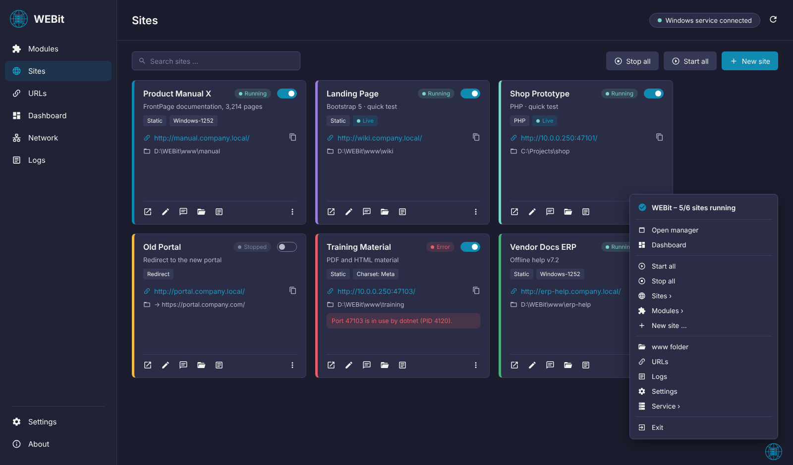

# WEBit

**Host any number of websites in parallel and test web projects live – each as its own card, with its own address and settings. A modern Windows app and service in the spirit of Laragon, for HTML, Bootstrap, PHP, Node.js and Python projects, documentation and manuals.**

WEBit turns a Windows server or PC into a multi-site web server in a few clicks. Every website is a **card**: choose a folder with HTML files – for example a classic Microsoft FrontPage documentation with thousands of pages – pick an address, done. Users in your network open the site with a fixed, bookmark-ready URL. WEBit runs as a **Windows service** in the background, so all sites keep running without anyone being signed in; the app and the **system tray** are only used to manage them. Web server, PHP, MariaDB, Node.js, Python and the mail catcher are **modules** you download with one click and switch on and off.

## Highlights

- **Quick test with live reload** — Drop a project folder on the window or into the `www` folder: WEBit creates a site (HTML/Bootstrap or PHP, detected automatically) and opens it in the browser. Every saved change reloads the page; CSS changes are swapped without a reload.
- **PHP and Mailpit with one click** — **Modules → Download** fetches the latest PHP and Mailpit from their official sources (checksum verified), PHP also installs the Visual C++ runtime. Errors appear in the browser, `mail()` goes to Mailpit, no setup needed.
- **Many sites in parallel** — Each website is a card with its own folder, address, color, charset and access rules. Switch each one on or off, edit, duplicate or delete it.
- **Modules with switches** — Web server (Caddy, included), PHP, MariaDB, Node.js, Python (uv) and mail catcher (Mailpit) – one-click download from the official source, one switch each.
- **Node.js and Python dev servers** — Point a site at a project folder: WEBit detects `npm run dev`, Vite, Next.js, Express, Django, Flask or FastAPI, gives the app its own internal port and puts it behind the site address. Dev mode for testing, **continuous operation** with automatic restart as an option.
- **MariaDB built in** — Local database on port 47204, reachable from this PC only (network access is one switch). Root password generated and stored encrypted; create a database with user in one click, back up all databases.
- **WordPress and Laravel in one click** — **Sites → Template** sets up WordPress (WP-CLI, database, admin account) or a Laravel project (Composer) and opens it.
- **Databases page with Adminer** — All MariaDB databases with size and sites; open in Adminer, back up, delete, create. Every backup is listed and can be **restored** with one click; **automatic backups** are available as an option (off by default).
- **Local HTTPS** — Certificates from a local WEBit CA per address; trust it on this PC with one click, export it for phones.
- **Several PHP versions** — Install e.g. PHP 8.2 next to the current version and choose the version per site – ideal for older projects.
- **Xdebug per site** — Switch step debugging on for one site; all others keep running without a debugger.
- **PHP settings, export/import, QR code** — Limits and extensions in the app; move sites with files and database as one ZIP, optionally **protected with a password** (AES-256); scan the site address with a phone.
- **Reverse proxy** — Publish any internal address (`http://127.0.0.1:3000/`, a container, another server) under a WEBit site.
- **Runs as a Windows service** — Sites stay online without sign-in (virtual account `NT SERVICE\WEBit`). No service? Use the **desktop mode** with one click.
- **No port conflicts** — Own port range (47100–47199), active check of used ports, Windows port reservations and other sites. Free ports are suggested automatically. Never “localhost”, never 8080.
- **Made for legacy documentation** — Detects FrontPage sites, hides their system folders (`_vti_*`, `_private`, …) and serves the right charset so special characters display correctly.
- **URL management** — Generate, check (DNS + HTTP) and copy URLs, copy a ready-made **message for users**, export **browser bookmarks** or **Edge/Chrome group policy** JSON.
- **Full tray control** — Status icon with traffic light; the tray menu starts and stops sites and modules, copies URLs, opens logs, switches the language and controls the service.
- **Modern interface** — Dark mode, collapsible sidebar (click the logo), icons on every button, English and German with flags, switch without restart.
- **Clean uninstall** — Removes the service, group, firewall rule, autostart and – on request – all data.
- **Local-first & secure** — No account, no telemetry. Control channel is a protected named pipe – no extra TCP port. Optional IP filter per site.

## Navigation

| Area | What you'll find |
| --- | --- |
| **Modules** | Web server, PHP, MariaDB, Node.js, Python (uv) and Mailpit with on/off switch, **Download / Update**, version, endpoint, log, folder and restart. MariaDB: root password, new database, backup. |
| **Databases** | MariaDB databases with size and sites: Adminer, backup, delete, new database, root password. All backups with **restore** and delete. |
| **Dependencies** | WEBit itself, Caddy, PHP (and additional PHP versions), Xdebug, Mailpit, MariaDB, Node.js, uv, Composer, WP-CLI, Adminer and the Visual C++ runtime: state, installed and latest version, path, license and source. Install, update, remove, check for updates – a new WEBit version opens its release page. |
| **Sites** | All websites as cards with switch, status, URL and folder: open, edit, copy message, logs, duplicate, delete. **New site** opens the editor. |
| **URLs** | Every address of every site in one list: check DNS/HTTP, copy URLs or a message, export bookmarks (HTML), group policy (JSON), CSV or `.url` shortcuts. |
| **Dashboard** | Start all / stop all, www folder, key figures, services with switches and notices. |
| **Network** | Host IP addresses, port ranges, ports in use with process, Windows-reserved ranges, port check with suggestion. |
| **Logs** | Service, web server, module and access logs per site – auto refresh. |
| **Settings** | Language, tray autostart, automatic desktop mode, port ranges, Mailpit, PHP and MariaDB ports, MariaDB network access, HTTPS (local CA), PHP limits and extensions, export & import, default IP, DNS suffix, paths, quick test, message template, service and uninstall. |
| **About** | Version, MIT license explained, all components with license and link. |

**Site editor** – tabs *General* (name, type – static, PHP, Node.js, Python, proxy, redirect – folder with **Analyze**, start command, continuous operation, environment variables, color), *Address* (IP, port, host name with live check), *Content* (charset, default documents, hidden paths, compression), *Access* (allowed networks) and *URLs* (public URL, deep links). The main action **Save & apply** is always on the right.

## Requirements

- Windows 10/11 or Windows Server 2019/2022/2025, 64-bit.
- Nothing else: the .NET runtime and Caddy are included.
- For PHP and Mailpit: internet access once for the download (windows.php.net, github.com, aka.ms) – or provide them manually, see *Modules without internet*.
- For the Windows service: administrator rights once during installation.
- For host names (e.g. `docs.company.local`): a DNS record pointing to the server.

## How To – Step by Step

**1 · Download & install**

1. Download the latest `webit_vX.Y.Z_setup.exe` or `webit_vX.Y.Z_portable.zip` from the [releases](https://github.com/complicatiion/WEBit/releases).
2. **Setup:** run it and choose the run mode:
   - **Windows service** – sites run without sign-in (servers, always-on PCs).
   - **Desktop mode** – sites run while you are signed in, WEBit starts with the tray (local testing).  
   **Portable:** extract it, e.g. to `C:\Tools\WEBit` (not to *Downloads*), and start **`WEBit.exe`**.
3. Optional: **Settings → Language** (English / German).
4. **Modules → Download missing modules** – PHP and Mailpit are downloaded, verified and started. For PHP, WEBit then asks to install the Visual C++ runtime (administrator prompt, only if missing).

**2 · Service (portable)**

1. On first start WEBit shows *“The WEBit service is not reachable”*.
2. Click **Install as Windows service** and confirm the Windows prompt – or **Start desktop mode** to just try it.
3. The pill in the header shows *Windows service connected*.

**3 · Test a project live (quick test)**

1. Drag your project folder (HTML, Bootstrap or PHP) onto the WEBit window – or copy it into the **www** folder (**Dashboard → www**).
2. WEBit creates the site, detects PHP and opens the **live view** in the browser.
3. Edit and save your files: the browser reloads at once. Stylesheets are refreshed without a reload.
4. Own pages without the live frame: add ``.

**4 · Publish a website**

1. Go to **Sites → New site**.
2. **Browse** to the folder with your HTML files and click **Analyze** – WEBit finds the start page, detects FrontPage and suggests the charset.
3. On the **Address** tab, keep the suggested IP and free port – or enter a host name with port 80 on a dedicated IP.
4. Click **Save & apply**. The switch is on, the card shows **Running**.

**5 · Share the URL**

1. Click the message icon on the card – a ready-made text with the URL is copied.
2. Paste it into an email or chat. For many users: **URLs → Export → Edge/Chrome group policy**.

**6 · Catch mails (optional)**

1. **Modules → Mailpit** – switch it on.
2. PHP's `mail()` already sends there; other apps use SMTP `127.0.0.1:47201`. **Open** shows all caught mails.

### Choosing the right address

| Option | Example | When to use |
| --- | --- | --- |
| **Host name on a dedicated IP** | `http://docs.company.local/` | Best for bookmarks. Add a second IP to the server, create DNS records, use port 80. |
| **WEBit port range** | `http://10.0.0.250:47101/` | No DNS needed. Works immediately next to other web servers. |
| **Public URL** | `https://docs.company.com/` | The site is published through a load balancer or reverse proxy. |

### Modules without internet

Copy the extracted files manually – WEBit finds them at the next start:

| Module | Folder (setup: `C:\ProgramData\WEBit`, portable: `data`) | Source |
| --- | --- | --- |
| PHP | `modules\php\php-cgi.exe` | [windows.php.net](https://windows.php.net/download/) – *VS17 x64 Non Thread Safe* ZIP |
| Mailpit | `modules\mailpit\mailpit.exe` | [github.com/axllent/mailpit](https://github.com/axllent/mailpit/releases) – `mailpit-windows-amd64.zip` |
| VC++ runtime | install `vc_redist.x64.exe` | [aka.ms/vs/17/release/vc_redist.x64.exe](https://aka.ms/vs/17/release/vc_redist.x64.exe) |

## Uninstall

- **Setup:** *Windows Settings → Apps → WEBit* or **Settings → Uninstall WEBit**. You are asked whether all data should be deleted as well.
- **Portable:** **Settings → Uninstall WEBit** removes service, group, firewall rule and autostart; optionally the program folder.
- Command line (administrator): `WEBit.Service.exe --uninstall [--purge]`.

## Privacy & Security

- Everything runs locally. WEBit sends no data anywhere and has no telemetry; fonts and icons are embedded. Only when you click **Download** on a module, the service contacts the official source (windows.php.net, api.github.com/github.com, aka.ms) – nothing is sent except the request itself.
- The app talks to the service through the local named pipe `\\.\pipe\WEBit.Control`, protected for administrators, the group **WEBit Admins** and the installing user. The admin API of the web server and Mailpit only listen on `127.0.0.1`.
- The service runs under the virtual account `NT SERVICE\WEBit`, not as SYSTEM. Grant it read access to site folders outside the WEBit folder.
- Sites can be limited to certain networks (**Access** tab). FrontPage system folders and `.git` are hidden by default.
- Data is stored in `%ProgramData%\WEBit` (portable: `data` next to the app), interface settings in `%AppData%\WEBit\ui.json`.
- Details: [licenses/PRIVACY.md](licenses/PRIVACY.md).

## Important Notes

- Only publish content you are allowed to share. Use IP filters for sensitive documentation.
- Ports **80/443** should only be used on an IP address that no other web server (IIS, http.sys) listens on. WEBit warns you about conflicts.
- WEBit does not execute `.asp` or server-side FrontPage components – static HTML, images, CSS and JavaScript are served as they are.
- Live reload sites send no-cache headers – switch live reload off in the site editor before publishing a site to users.
- Closing the window keeps WEBit in the tray; **Exit** closes only the app – the service and all sites keep running.
- Please report problems with the service log (**Logs → Service**).

More help: [docs/HANDOUT.md](docs/HANDOUT.md) · Features: [docs/FEATURES.md](docs/FEATURES.md) · Ports: [docs/PORTS.md](docs/PORTS.md) · Build: [docs/BUILD.md](docs/BUILD.md) · Changes: [docs/CHANGELOG.md](docs/CHANGELOG.md)

## Credits

WEBit is inspired by **[Laragon](https://laragon.org/)** and built on **[Caddy](https://caddyserver.com/)** by the Caddy authors (Apache 2.0), which serves all websites, and **[Mailpit](https://mailpit.axllent.org/)** by Ralph Slooten (MIT), and runs **[PHP](https://www.php.net/)** (PHP License 3.01). The interface is made with **[Avalonia UI](https://avaloniaui.net/)** and **[CommunityToolkit.Mvvm](https://github.com/CommunityToolkit/dotnet)**, the service with **[.NET](https://dotnet.microsoft.com/)** and **Microsoft.Extensions.Hosting**. Icons: **[Material Design Icons](https://pictogrammers.com/library/mdi/)**, font: **[Inter](https://rsms.me/inter/)**. Thank you to all authors – licenses in [licenses/README.md](licenses/README.md).

## Project & Copyright

WEBit is a personal software project by **Sven Klocke** (*sksdesign | complicatiion*).

**Project repository:** [github.com/complicatiion/WEBit](https://github.com/complicatiion/WEBit)  
**Website:** [sksdesign.de](https://sksdesign.de)

WEBit is released under the **MIT License** ([licenses/LICENSE.md](licenses/LICENSE.md)). It is provided without warranty; liability is limited to the extent permitted by law – see [licenses/LEGAL-NOTICE.md](licenses/LEGAL-NOTICE.md) and [licenses/COPYRIGHT.md](licenses/COPYRIGHT.md). Third-party components keep their own copyrights and licenses: [licenses/README.md](licenses/README.md).

Windows, Windows Server, Microsoft Edge, Google Chrome, FrontPage, Laragon, Caddy, PHP and Mailpit are trademarks of their respective owners. WEBit is not affiliated with or endorsed by them.
